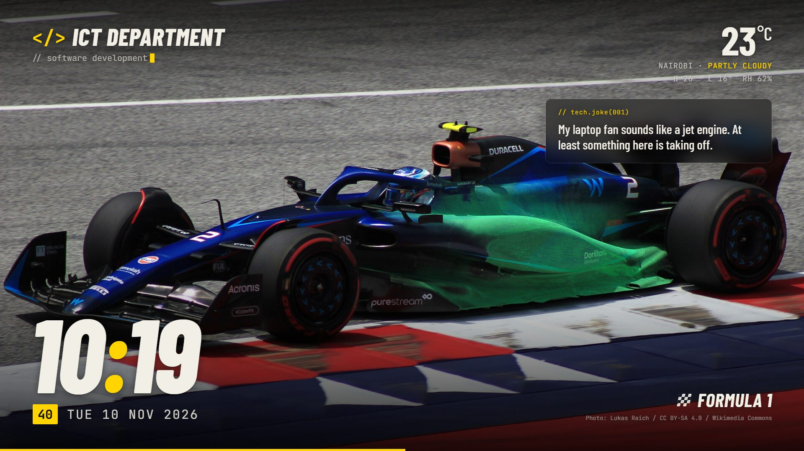
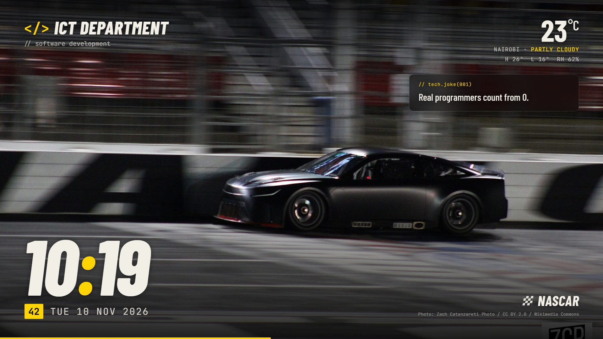

# Samsung-TV

Idle screen for a Samsung Tizen TV: big clock, Nairobi weather, rotating motorsport wallpapers (Formula 1, 24 Heures du Mans, GT3, NASCAR, Rolex 24 at Daytona, Rally, IMSA) and tech jokes in a blurred card. A Python watcher serves the page and opens it full screen on the TV after a few idle minutes, via samsung-tv-ws-api.



| Rally | NASCAR |
|---|---|
|  |  |

## What it shows

* **Big clock** — current time in Nairobi (East Africa Time), independent of the TV's own clock settings, with a seconds chip and the date.
* **Nairobi weather** — temperature, conditions, today's high/low and humidity from Open-Meteo (no API key needed), refreshed every 15 minutes.
* **Rotating wallpapers** — 243 hand-picked race-action photos from Wikimedia Commons, each labelled with its series and photographer credit, changing every 20 seconds with a slow Ken Burns drift and a progress bar.
* **Tech jokes** — a blurred "glass" card (`// tech.joke(001)`) under the weather with a new joke on every photo change: a local deck of 154 programming/IT jokes mixed with safe-mode programming jokes from JokeAPI when online.

| Series | Photos | Label |
|---|---|---|
| Formula 1 | 94 | FORMULA 1 |
| GT3 | 40 | GT3 RACING |
| Rally | 32 | RALLY |
| NASCAR | 29 | NASCAR |
| Le Mans | 21 | 24 HEURES DU MANS |
| IMSA | 18 | IMSA SPORTSCAR |
| Daytona | 9 | ROLEX 24 AT DAYTONA |

## How it works

The TV can't report its input or a "No Signal" state, so "idle" means: the TV is on, none of its streaming apps (YouTube, Netflix, Prime Video, Spotify, …) is visible, and the idle screen page itself isn't showing.

1. `ict_screen.py` serves `screen/` on `http://<pc-ip>:8765/` and watches the TV over the local network (Samsung TV WebSocket API, port 8001).
2. After 5 idle minutes it opens the page on the TV browser via `tv.py` (`samsungtvws.SamsungTVWS`, `open_browser`), waits for it to load, then presses OK (`KEY_ENTER`) so the page can switch to full screen.
3. The page pings the watcher every 15 s (including whether it's full screen) so it knows the screen is still showing. If someone switches to another input, the watcher waits 15 minutes before reopening.

The 2018 Tizen browser has no `backdrop-filter`, so the joke card's blur is a blurred copy of the current wallpaper lined up behind the card.

## Files

* `ict_screen.py` — HTTP server + idle watcher; runs on the PC
* `tv.py` — Samsung TV remote control (info, apps, keys, launch apps, open the screen full screen)
* `screen/index.html` — the idle screen (ES5, written for the 2018 Tizen browser)
* `screen/photos.js` — wallpaper list with series and photo credits
* `screen/quotes.js` — local tech-joke deck
* `screen/img/` — the wallpapers
* `docs/screenshots/` — screenshots for this README
* `.gitignore` — ignores the TV pairing token, watcher log and `__pycache__`

## Requirements

* Python 3
* `samsungtvws` — `pip install samsungtvws`
* A PC on the same network as the TV that stays on while the screen is in use

## Usage

1. Edit `HOST` in `tv.py` to your TV's IP (default `192.168.0.88`).
2. Run `python ict_screen.py` on a PC reachable by the TV.
3. The first run shows an "Allow" prompt on the TV; the pairing token is saved to `tv-token.txt` (ignored by git).
4. Leave the TV idle for 5 minutes and the screen opens full screen.

Open it straight away, or control the TV by hand:

```bash
python tv.py browse http://<pc-ip>:8765/
python tv.py apps
python tv.py key KEY_VOLUP 3
```

### Start automatically on Windows

Put a launcher in the Startup folder (`Win+R` → `shell:startup`), e.g. `ICT TV Screen.vbs`:

```vbscript
Set sh = CreateObject("WScript.Shell")
sh.CurrentDirectory = "C:\path\to\Samsung-TV"
sh.Run "cmd /c python -u ict_screen.py >> ict_screen.log 2>&1", 0, False
```

It starts the watcher hidden at every sign-in and logs to `ict_screen.log`.

### Settings

* Idle times — `IDLE_MINUTES` (default 5) and `DISMISSED_IDLE_MINUTES` (default 15) in `ict_screen.py`
* City and timezone — `CITY` and `UTC_OFFSET_HOURS` in `screen/index.html`
* Photo time — `SLIDE_SECONDS` (default 20) in `screen/index.html`
* Jokes — add lines to `screen/quotes.js`

Tip: reserve the TV's and PC's IP addresses in your router so they don't change.

## Photo credits

All wallpapers are from [Wikimedia Commons](https://commons.wikimedia.org/) under Creative Commons or public-domain licences. Each photo's author and licence are listed in `screen/photos.js` and shown on screen while it's displayed.

TV model: Samsung UA49N5300 (2018 Tizen).
